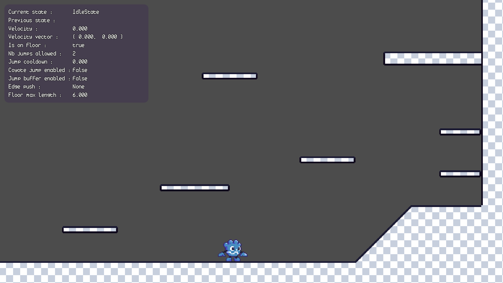

A simple and complete 2D platformer controller asset, made in Godot 4.

# **General**

This asset provides a fully commented, finite state machine based 2D side-view/platformer controller with a debug properties HUD.

It is 100% written in GDScript and follows GDScript conventions. My main goal with this project is to provide an easy and complete way to manage and modify a controller for 2D side view games, especially platformers.

A test map is provided to test the controller.

A cute 2D animated character is also provided, to have a nicer test character than the capsule.

The controller uses a finite state machine architecture where each state has its own script, making it straightforward to add, remove, or modify behaviors. All movement parametersand keybindings are exposed as export variables in the inspector for easy customization.

# Compatibility

- **Godot 4.4 - 4.7**: Fully supported.
- **Godot 4.0 - 4.3**: Should work, but you will need to delete the `.uid` files.

# **Features**

**Movement**
- Finite state machine based controller
- Smooth acceleration and deceleration
- Walking
- Slope traversal
- Jumping (configurable multi-jump)
- Jump buffering
- Coyote time
- Variable jump height
- Edge/Corner correction
- Air control (customizable via curves)

 **UI**
 - Properties HUD

 **Misc**
 - Input action checker

# Installation / Quickstart

## Step 1: Add the asset to your project

Download or clone this repository and copy the `addons/` folder into your Godot project's root directory.

## Step 2(optional): Set up input actions

The controller requires **3 input actions** to be defined in your project's Input Map. If they are not binded, the default keybindings will be used. Go to **Project > Project Settings > Input Map** and create each of the following actions, then bind them to your preferred keys/buttons.

By default, the key actions are defined as "play_char_{action_name}_action". Do not change this name unless you have configured your own key bindings.

To change the keybinds in the scripts, i have set up one that center all the inputs needed, so you won't have to go in differents files each time you want to modify something. The script is called "input_management_component_script", it is located in the player character scene.

| Input Action Name | Purpose | Default key |
|---|---|---|
| `play_char_move_left_action` | Move left | Q, Left |
| `play_char_move_right_action` | Move right | D, Right |
| `play_char_jump_action` | Jump | Z, Space, Up |

## Step 3(optional): Set up collisions

Collisions masks and layers are already set up in the scenes, but for more clarity you can name them in the "2D Physics" section of your Godot projet settings window, as following :
- 1 : world
- 2 : player_character

## Step 4(optional) : Change texture filtering
In Godot, the default texture filtering is set on Linear, which makes pixel art looks blurry.
To make it look nice, change the setting to Nearest.

# State machine overview

The controller uses 5 states, each in its own script:

| State | Description |
|---|---|
| **Idle** | No movement input. Handles jump buffering. |
| **Move** | Standard movement at base speed. |
| **Jump** | Active jump with air control. Handles edge/corner correction and multiple jumps |
| **InAir** | Airborne without jumping (e.g., walked off an edge). Handles coyote time, jump buffering, and multiple jumps. |

# Issues and contributions

- **Bug reports**: Open an issue in the [Issues](../../issues) section.
- **Feature requests**: Post in the [Discussions](../../discussions) section.
- **Pull requests**: Submit improvements in the [Pull Requests](../../pulls) section.

# **Credits**

- 2D character original idea, plus idle and walk sprites by SplendidDog : https://splendiddog.itch.io/simply-plush.
- 2D character jump and fall sprites by Mygule.
- Prototype tilesets by GiMiCkO : https://gimicko.itch.io/platformer-tileset-template.

# Donations

If you like my assets, and want to support my work : https://ko-fi.com/jeheno.
